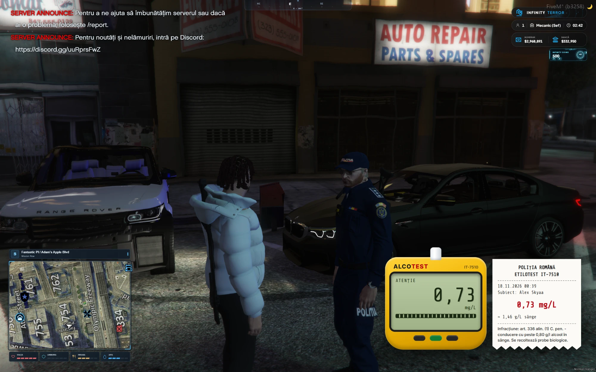

# FiveM Substance Tests — breathalyzer & drug tests for police roleplay

A resource for a **FiveM (GTA V multiplayer) roleplay server** built on the ESX framework. It simulates what a person consumes
(food, drinks, alcohol, drugs), keeps a **server-side model of each character's body**, and lets police officers run
**breathalyzer and saliva drug tests** that are logged in a **MySQL/MariaDB** database and shown on an in-game device UI.

It runs on a live community server and was tested in-game with real players.

> 🇷🇴 [Versiunea în română](README.ro.md)



*An in-game breathalyzer test: 0.73 mg/L breath (≈ 1.46 g/L blood), classified as a criminal offence, with the printed receipt.*

## What it does

- **Consumables** — eating/drinking/smoking with animations and props; hunger/thirst integration.
- **Blood alcohol model (server-authoritative)** — every drink is first "in the stomach" and is absorbed gradually
  (0.10 ‰/min) while the liver eliminates 0.01 ‰/min. Persisted per character (survives reconnects/restarts).
- **Effects by level** — visual filter, camera sway, drunk walking styles, distorted audio, steering drift while driving,
  stumbling, vomiting, passing out. Drugs (THC, methamphetamine) have their own effect windows and detection windows.
- **Police tests** — an on-duty officer uses the device near a person, who must **accept or refuse** (refusal is recorded,
  as it is an offence under Romanian law). The result is calculated **on the server**, shown on a device UI to both players,
  and stored in SQL.
- **Toxicology** — a blood sample keeps the exact body state at collection time and can be analysed in a police lab resource.
- **Custom 3D models** for both devices (made in Blender), used in-hand and when dropped on the ground.

## Tech stack

| Layer | Technology |
|---|---|
| Server logic | Lua 5.4 (FiveM runtime), ESX framework, ox_lib callbacks |
| Database | MariaDB / MySQL via oxmysql (parameterised queries) |
| UI (NUI) | HTML, CSS, vanilla JavaScript (runs in the game's embedded Chromium) |
| Shared model | JavaScript port of the BAC model + unit tests (`node:test`) |
| Assets | Blender + Sollumz (GTA V model export) |

## Engineering points worth a look

- **The server is the source of truth.** The client only plays animations; the item is removed and effects are applied
  only after the server validates a one-time "pending use" token (`server/corp.lua`). Clients cannot fake a result.
- **Consent flow with timeouts** — sessions are always released (wrapped in `pcall`), with a 60 s safety expiry
  (`server/teste.lua`).
- **Deterministic, testable model** — the same absorption/elimination algorithm runs on server and client;
  a JavaScript port with unit tests lives in [`js/bac-model.js`](js/bac-model.js).
- **SQL** — schema and example reporting queries in [`sql/schema.sql`](sql/schema.sql).

## Project structure

```
resource/it_substante/   the FiveM resource (Lua server + client, NUI, 3D models)
  server/corp.lua        body model: alcohol + drugs, persistence, consumption validation
  server/teste.lua       breathalyzer / drug test sessions, consent, SQL logging
  server/tox.lua         blood sample collection + lab analysis export
  client/efecte.lua      effects engine
  web/                   device UI (HTML/CSS/JS)
js/bac-model.js          BAC model in JavaScript
test/                    unit tests (node --test)
sql/schema.sql           database schema + example queries
docs/ARCHITECTURE.md     flow diagrams
docs/etilotest.webp      in-game screenshot
```

## Run the tests

```bash
npm test
```

No dependencies are needed (Node.js 18+).

## Notes

- Comments in the Lua code are in Romanian (the server's language).
- This project was developed **with the help of an AI coding assistant**; I directed the design (how each mechanic should
  work in real life), tested everything in-game with players and debugged the issues found.

## License

MIT — see [LICENSE](LICENSE).
