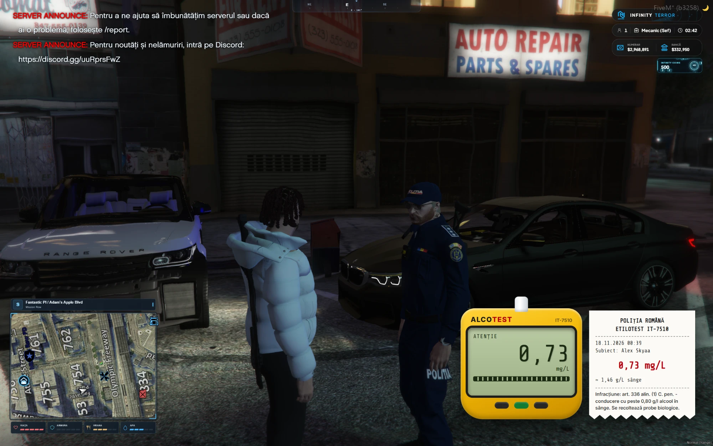

# FiveM Substance Tests — etilotest și drugtest pentru roleplay cu poliție

Resursă pentru un **server FiveM (GTA V multiplayer) de roleplay** pe framework-ul ESX. Simulează ce consumă o persoană
(mâncare, băuturi, alcool, droguri), ține pe server un **model al corpului fiecărui personaj** și permite polițiștilor
să facă **teste cu etilotestul și drugtestul salivar**, salvate într-o bază de date **MySQL/MariaDB** și afișate pe un
aparat în joc.

Rulează pe un server live și a fost testată în joc, cu jucători reali.



*Test cu etilotestul în joc: 0,73 mg/L aer expirat (≈ 1,46 g/L sânge), încadrat ca infracțiune, cu bonul tipărit.*

## Ce face

- **Consum** — mâncat, băut, fumat, cu animații și obiect în mână; legat de foame/sete.
- **Model de alcoolemie pe server** — fiecare băutură ajunge întâi „în stomac” și trece treptat în sânge (0,10‰/min),
  iar ficatul elimină 0,01‰/min. Salvat pe personaj (rămâne și după relogare/restart).
- **Efecte pe niveluri** — filtru de imagine, cameră, mers de om beat, sunet distorsionat, volanul „trage”, împiedicări,
  vomă, leșin. Drogurile (THC, metamfetamină) au efect și fereastră de detectare proprii.
- **Testele poliției** — polițistul în tură folosește aparatul lângă persoană, care **acceptă sau refuză** (refuzul se
  consemnează — e infracțiune în România). Rezultatul se calculează **pe server**, apare pe aparat la amândoi și se
  salvează în SQL.
- **Toxicologie** — proba de sânge reține starea corpului din momentul recoltării și se analizează în laboratorul poliției.
- **Modele 3D proprii** pentru ambele aparate (Blender), în mână și aruncate pe jos.

## Tehnologii

Lua 5.4 (FiveM), ESX, ox_lib · MariaDB/MySQL (oxmysql, interogări parametrizate) · HTML/CSS/JavaScript (NUI) ·
JavaScript + teste unitare (`node:test`) · Blender + Sollumz.

## Rulare teste

```bash
npm test
```

## Note

Proiectul a fost dezvoltat **cu ajutorul unui asistent AI pentru cod**; eu am stabilit cum trebuie să funcționeze fiecare
mecanică (ca în realitate), am testat totul în joc cu jucători și am depanat problemele găsite.

Licență: MIT.
