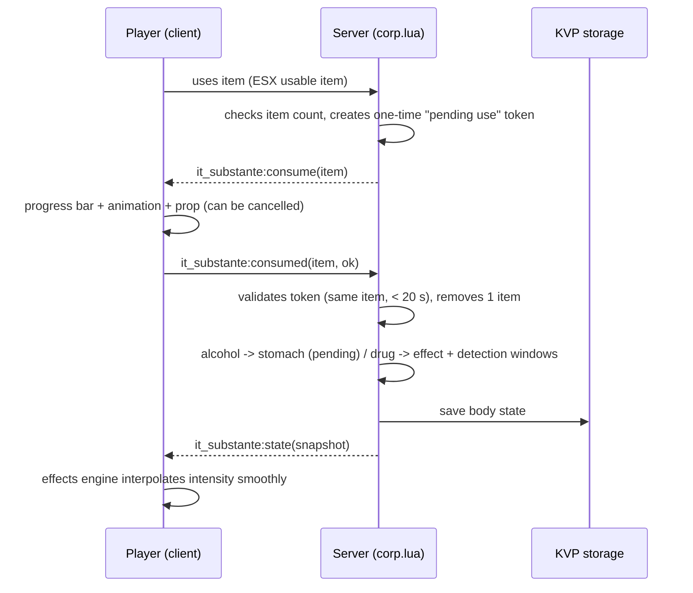
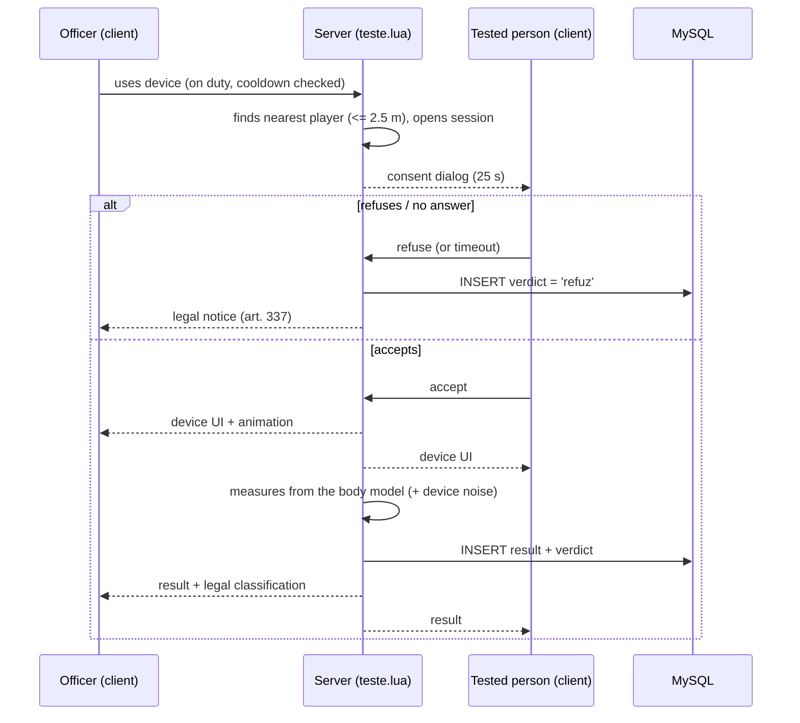

# Architecture

## Consuming an item (server-authoritative)

## Breathalyzer / drug test

## Body model

- Alcohol: `pending` (stomach) -> `bac` (blood), absorption 0.10 ‰/min, elimination 0.01 ‰/min, simulated in 1-minute steps.
- Breathalyzer: `mg/L = BAC / 2` (Romanian standard: 0.40 mg/L breath = 0.80 g/L blood).
- Drugs: each dose extends the effect window (capped) and resets the detection window (THC 120 min, meth 60 min).
